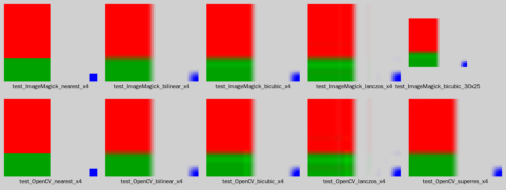

# FLC Upscale

A small C library for [ReMoM](https://github.com/jbalcomb/ReMoM). It takes an 8-bit palettized image (a decoded FLIC frame, a
picture bitmap or a screen page), turns it into a larger 32-bit RGBA image, and writes it as a 32-bit PNG. Either
**ImageMagick** (MagickWand) or **OpenCV** does the resampling and PNG encoding; you choose which one on each call.

It doesn't include any MoX or MoM headers, so it links into ReMoM, HeMoM or a standalone tool without changes.



*The test picture at 4x, with every backend and filter. Light grey is transparency.*

## API

```c
#include "Upscale.h"

struct s_UPSCALE_OPTIONS options;
struct s_UPSCALE_IMAGE image;

Upscale_Default_Options(&options);
options.backend = UPSCALE_BACKEND_IMAGEMAGICK;   /* or UPSCALE_BACKEND_OPENCV */
options.filter  = UPSCALE_FILTER_LANCZOS;        /* NEAREST, BILINEAR, BICUBIC, LANCZOS, SUPERRES */
options.scale   = 4;                             /* or set dst_width / dst_height for any size */

/* A decoded ReMoM picture: 16-byte header + column-major pixels, 6-bit VGA palette, index 0 transparent */
if(Upscale_Bitmap(bitmap, current_palette, &options, &image) == UPSCALE_OK)
{
    /* image.rgba: width * height * 4 bytes, R G B A, row-major; image.png / image.png_size: the PNG file contents */
    Upscale_Write_PNG_File(&image, "FIGURES1_003.png");
    Upscale_Free_Image(&image);
}
else
{
    fprintf(stderr, "%s\n", Upscale_Last_Error());
}
```

To pass any other buffer, describe it with `struct s_UPSCALE_SOURCE` and call `Upscale_Image()`:

| Field | Meaning |
|---|---|
| `pixels`, `width`, `height` | The palette indices |
| `stride` | Bytes between rows (row-major) or columns (column-major). 0 means tightly packed |
| `layout` | `UPSCALE_LAYOUT_ROW_MAJOR` for the screen and video pages, `UPSCALE_LAYOUT_COLUMN_MAJOR` for decoded pictures (`pict_seg`) |
| `palette` | 256 × 3 bytes, R G B |
| `palette_format` | `UPSCALE_PALETTE_VGA6` (0–63 stretched to 0–255), `UPSCALE_PALETTE_VGA6_SHIFT2` (0–63 shifted left by 2, giving 0–252, which is what the SDL and headless renderers do), or `UPSCALE_PALETTE_RGB8` |
| `transparent_index` | The palette index that becomes alpha 0, or `UPSCALE_NO_TRANSPARENCY` |

`Upscale_Indexed_To_RGBA()` does the palette expansion alone, with no scaling. Every function returns an
`e_UPSCALE_RESULT`. On failure, `Upscale_Last_Error()` describes what went wrong and where.

### Filters

| Filter | ImageMagick | OpenCV |
|---|---|---|
| `NEAREST` | `MagickSampleImage` (exact copy, no blending) | `INTER_NEAREST` |
| `BILINEAR` | `TriangleFilter` | `INTER_LINEAR` |
| `BICUBIC` | `CatromFilter` (Catmull-Rom) | `INTER_CUBIC` |
| `LANCZOS` | `LanczosFilter` | `INTER_LANCZOS4` |
| `SUPERRES` | not available | `dnn_superres` neural model (EDSR, ESPCN, FSRCNN or LapSRN) |

To use `SUPERRES`, set `superres_model_path` (for example `ESPCN_x4.pb`) and `superres_model_name` (`"espcn"`).
It needs OpenCV built with the opencv_contrib `dnn_superres` module. Models are available from
[opencv_contrib/modules/dnn_superres](https://github.com/opencv/opencv_contrib/tree/master/modules/dnn_superres).

### Transparency

Transparent pixels must not darken the edges of a sprite when it is filtered:

* **ImageMagick** already weights by alpha when it resizes.
* **OpenCV's** `cv::resize` doesn't know about alpha. The expanded image is already premultiplied (transparent pixels are
  0,0,0,0 and all other pixels are opaque), so the backend resizes it as-is and divides by alpha afterwards.
* **Super-resolution** models only see color. Before running the model, edge colors are spread outward into the
  transparent area, where they stay invisible.

The tests check sprite edges for each of these.

## Build

```bash
# Debian / Ubuntu
sudo apt-get install libmagickwand-dev libopencv-dev

# MSYS2 (Windows)
pacman -S mingw-w64-x86_64-imagemagick mingw-w64-x86_64-opencv

cmake -S . -B build
cmake --build build
ctest --test-dir build --output-on-failure

# optional: also test super-resolution with a real model
UPSCALE_SUPERRES_MODEL=/path/to/ESPCN_x4.pb ./build/test_upscale build/test_output
```

Each backend is controlled by a cache variable: `UPSCALE_WITH_IMAGEMAGICK` and `UPSCALE_WITH_OPENCV` each take `AUTO`
(the default, which uses the library if it is found), `ON` (a missing library is an error) or `OFF`. Both ImageMagick 6
and ImageMagick 7 work. CMake finds MagickWand through pkg-config, and falls back to `find_package(ImageMagick)`.

## Using it in ReMoM

1. Copy this folder into the ReMoM tree (for example `ext/flc-upscale/`) and add it to the build behind an option, so the
   default build has no new dependencies:

   ```cmake
   option(REMOM_UPSCALE "Build the ImageMagick/OpenCV upscaler" OFF)
   if(REMOM_UPSCALE)
       add_subdirectory(ext/flc-upscale)
       target_link_libraries(ReMoM PRIVATE Upscale)
   endif()
   ```

   The tests don't build as part of ReMoM, because they only build when this project is the top-level project.
   ReMoM's `AGENTS.md` requires running `tools/vet_dependency.py` before adding ImageMagick or OpenCV.

2. Export every frame of a FLIC. `Draw_Picture_To_Bitmap()` decodes the picture's current frame, including the delta
   frames it builds on, into a column-major bitmap, and loads that frame's palette into `current_palette`:

   ```c
   int16_t frame_count = FLIC_Get_FrameCount(pict_seg);
   int16_t itr_frame = 0;
   char path[64];
   /* work_bitmap: at least 16 + (width * height) bytes */
   for(itr_frame = 0; itr_frame < frame_count; itr_frame++)
   {
       Set_Animation_Frame(pict_seg, itr_frame);
       Draw_Picture_To_Bitmap(pict_seg, work_bitmap);
       snprintf(path, sizeof(path), "%s_%03d_%03d.png", lbx_name, entry_num, itr_frame);
       if(Upscale_Bitmap(work_bitmap, current_palette, &options, &image) == UPSCALE_OK)
       {
           Upscale_Write_PNG_File(&image, path);
           Upscale_Free_Image(&image);
       }
   }
   ```

3. To upscale the whole screen, pass `video_page_buffer[n]` as a 320 × 200 `UPSCALE_LAYOUT_ROW_MAJOR` source with
   `UPSCALE_NO_TRANSPARENCY`.

## Things to know

* Remap pictures (`FLIC_GET_REMAP_FLAG`) use some palette indices as see-through shading, which the game applies through
  remap tables at draw time. Here those indices become opaque palette colors. To get real alpha for them, map them to
  RGBA before scaling.
* `Upscale_Last_Error()` uses a single shared buffer, so call the library from one thread at a time.
* ImageMagick is set up on first use. Call `Upscale_Shutdown()` at exit to release it.
