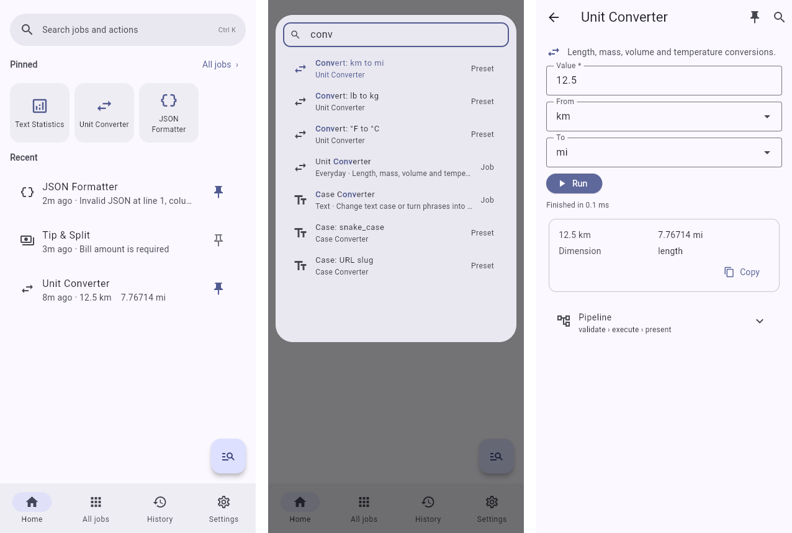

# TaskDeck

A general-purpose Android app (Python + [Flet](https://flet.dev)) that gives every kind of job one consistent,
easy-to-navigate interface. Each job is a **plugin**, each plugin runs as a **pipeline** of steps, and an ongoing
**plugin review** looks for shared code and pipeline patterns to pull into common modules.



## Navigation at a glance

| Where | What it does |
|---|---|
| **Search pill / FAB / Ctrl+K** | Opens the **command palette**: fuzzy search over every job, job preset and action. `>` limits to actions, `@` to jobs. Arrow keys and Enter work with a keyboard; frequently used items rise to the top. |
| **Home** | **Pinned** tiles (Windows 11 start-menu style). Tap to open; long-press to reorder or unpin. Below them, **Recent** jobs with their last result. |
| **All jobs** | Every installed job, grouped by category, with a pin toggle on each. |
| **History** | Every run with its outcome. Tap one to reopen the job with the same inputs. |
| **Settings** | Theme (system/light/dark) and the list of keyboard shortcuts. |

Every job screen has the same layout: a form generated from the plugin's fields, **Run**, live step-by-step
progress, the result with **Copy**, and an expandable **Pipeline** panel that shows each step, its stage and
its timing.

## Run it

```bash
python -m venv .venv && . .venv/bin/activate
pip install "flet[all]==1.0.4" "fastapi<0.120" pytest   # fastapi pin: needed by flet-web 1.0.4
flet run src/main.py            # desktop window
flet run --web src/main.py      # browser
pytest                          # tests
```

## Build the Android APK

`flet build` needs the Flutter SDK and the Android SDK ([Flet publishing guide](https://flet.dev/docs/publish/android)):

```bash
flet build apk      # or: flet build aab  (for the Play Store)
```

App metadata (package id, product name) is in `pyproject.toml` under `[tool.flet]`. On the device, state is
stored as JSON in the app's private storage (`FLET_APP_STORAGE_DATA`).

## Jobs

| Job | Notes |
|---|---|
| **Extract archive** | Unpack zip, 7z, RAR, tar and gz (password-protected too) into a folder on the phone, in the background. Needs the APK with file access. [docs/jobs/extract_archive_SPEC.md](docs/jobs/extract_archive_SPEC.md). |
| **Parse executable** | Split a DOS or Windows .exe (MZ, PE, NE) into small text files an AI agent can walk or search: summary and layout, metadata, headers, hex chunks, strings. Optionally mirrored to Google Drive. [docs/jobs/exe_parse.md](docs/jobs/exe_parse.md). |
| **Parse DLL** | The same for .dll and other libraries, with the exports table (ordinal, name, address, chunk file; forwarders; 16-bit NE too). Shares Parse executable's Drive folder. [docs/jobs/dll_parse.md](docs/jobs/dll_parse.md). |
| **Daily Log to Sheet** | Paste a delivery log → local AI extracts it → preview → append to Google Sheets. Needs setup: [docs/jobs/daily_log.md](docs/jobs/daily_log.md). |
| Text Statistics, Case Converter, Hash / Checksum, JSON Formatter, Unit Converter, Tip & Split | Offline examples of the plugin pattern. |

Jobs can have **settings** (tune icon on the job screen, or *Settings → Job settings*) and a **two-step run**:
the first button builds a preview without side effects, and a second button commits it.

## Add a job

```bash
python tools/new_job.py word_freq "Word Frequency" --category Text
```

This creates `src/taskdeck/jobs/word_freq/__init__.py`. Fill in the fields and steps, add tags, then run
`python -m taskdeck.review`. The job appears in All jobs and the palette automatically. See
[docs/ARCHITECTURE.md](docs/ARCHITECTURE.md) for the plugin contract.

Planned work: [TODO.md](TODO.md).

Saving to Google Drive needs a one-time setup: [docs/GOOGLE_DRIVE_SETUP.md](docs/GOOGLE_DRIVE_SETUP.md).
Jobs that copy files are either a one-time copy of a fixed snapshot or an ongoing sync, and that decides what
happens to files already there: [docs/JOB_KINDS.md](docs/JOB_KINDS.md).

Credentials (settings marked `secret=True`) are kept in a vault your fingerprint unlocks: see
[docs/CREDENTIALS.md](docs/CREDENTIALS.md).

## Layout

```
src/
  main.py                  Flet entry point
  taskdeck/
    core/                  UI-agnostic: plugin contract, pipeline, commands + fuzzy search, favorites, storage
    shared/                steps and helpers extracted from jobs (grows through the plugin review)
    jobs/                  one sub-package per job plugin (auto-discovered)
    review/                commonality analyzer: python -m taskdeck.review
    ui/                    Flet screens; the only package that imports flet
tests/                     pytest suite (core, jobs, palette ranking, review)
tools/new_job.py           job scaffold
docs/                      architecture and plugin-review process
```
